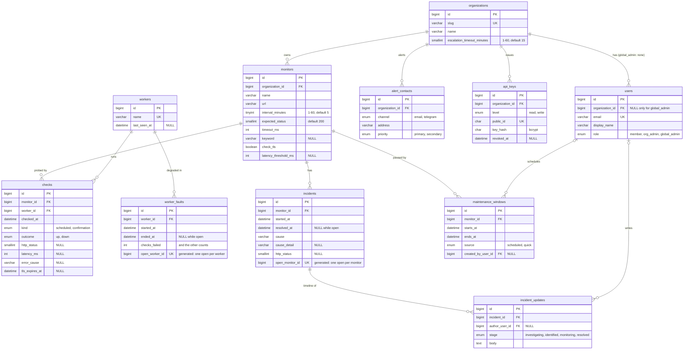

# Architecture — status-page-uptime-monitoring

<!-- graffino-agentic:begin v1 -->
> How this repo is built, generated from the code at backfill and kept current by
> whoever changes the structure. The code wins: when this page is wrong, fix it.
<!-- graffino-agentic:end -->

## Overview
Status page + uptime monitoring is an availability monitoring and status page platform. It periodically probes external services
via separated check workers, detects outages using two-worker confirmation, manages incident lifecycles,
sends alerts, and serves sub-100ms cached public status pages per organization.

```text
                  +----------------------------------------------+
                  |                  MySQL 8.4                   |
                  | (monitors, incidents, checks, roll-up metrics)|
                  +----------------------+-----------------------+
                                         ^
                                         |
     +-----------------------------------+-----------------------------------+
     |                                   |                                   |
     v                                   v                                   v
+-----------------------+     +-----------------------+     +-----------------------+
|      Fastify Web      |     |    Check Worker 1     |     |    Check Worker 2     |
| (API, SSR Status Page,|     |  (scheduler, probes,  |     |  (scheduler, probes,  |
|  in-memory cache)     |     |   failure candidate)  |     |   confirmation probe) |
+-----------+-----------+     +-----------+-----------+     +-----------+-----------+
            |                             |                             |
            v                             +--------------+--------------+
       [ Browsers ]                                      |
 (Public Status / Admin UI)                              v
                                            +-------------------------+
                                            | External Targets & APIs |
                                            | (HTTP, TLS, Telegram)   |
                                            +-------------------------+
```

## Parts
Source is split into `src/web/` (web process), `src/worker/` (check worker
processes), `src/shared/` (code both use, e.g. the `Clock` in `src/shared/clock.ts`)
and `src/db/` (database connection and migration runner). SQL migrations live in
`db/migrations/` at the repo root. Paths marked _planned_ do not exist yet.

| Part | Path | Responsibility | Talks to |
|---|---|---|---|
| Web Server | `src/web/` (`app.ts`, `server.ts`) | Serves Fastify REST API, SSR status pages, admin views; `GET /health`; `GET /status` (DS-p26-public-status) when `DATABASE_URL` is set | MySQL, in-memory cache |
| Public Status Page | `src/web/status/` (`model.ts`, `data.ts`, `render.ts`), `src/web/views/status.html`, `src/web/public/` | Loads monitors, last checks, incidents with their updates and maintenance windows over the 90 × 24 h before now; derives each monitor's status, 90- and 30-day uptime and 90 daily bars, the active incidents and the past incidents (D-032); renders the Eta template with the tokens inlined. Whatever later writes `incident_updates` must bump `status_version` (D-020) | MySQL, In-Memory Cache |
| Docs Page | `src/web/docs/` (`search.ts`, `render.ts`), `src/web/views/docs.html`, `src/web/views/docs/*.html` | `GET /docs` (DS-p26-docs): how monitoring works, filtered by `?q=` on the server (D-024: no script) | — |
| Shared page parts | `src/web/page.ts`, `src/web/views/partials/`, `src/web/public/base.css` | Eta, inlined tokens and shared styles, icons, the header and the theme toggle used by `/status` and `/docs` | Web Server |
| In-Memory Cache | `src/web/status/cache.ts` | Keeps the rendered status page; reads `status_version` at most every 30 s on a request, re-renders on a new version, at UTC midnight or a maintenance boundary; serves the last copy if MySQL fails | Web Server |
| Scheduler | `src/worker/scheduler.ts` | Fixed grid per monitor (interval plus a per-monitor offset), no catch-up, a slot skipped while the previous check runs (D-027) | Check Workers |
| Check Engine | `src/worker/check.ts`, `src/worker/http-client.ts` | One check through an injected `HttpClient` and `Clock`: status, keyword, latency threshold, TLS days left, failure cause; default timeout 30 s (D-022). `nodeHttpClient` is the real client: GET, up to 5 redirects, whole body, certificate of the last hop (D-026) | External Targets (via the client) |
| Check Workers | `src/worker/main.ts`, `worker.ts`, `assignment.ts`, `store.ts` | One process per `WORKER_NAME` (`npm run start:worker`): heartbeat 10 s, monitors re-read 60 s, scheduled checks of the monitors it is primary for (`monitor_id % active workers`), confirmations of the other worker's `down` checks polled every 5 s; records each check under the monitor's row lock (D-027) | MySQL, External Targets |
| Worker Degradation | `src/shared/worker-fault.ts` | Judges a worker over the last 10 min of its scheduled checks: ≥ 3 monitors, ≥ 70 % failed, ≥ 70 % of the confirmed failures confirmed up by the other worker (D-015). `recordCheck` opens no incident while a worker behind the run is degraded; each heartbeat opens or ends the worker's `worker_faults` episode | MySQL |
| Incident Engine | `src/shared/incidents.ts`, `src/shared/uptime.ts` | Opens after 2 confirmed failures outside maintenance, resolves after 2 successes (D-006, D-028); says when the status version must change; run by the workers inside `recordCheck`. `uptime()` computes a period's uptime from incidents and maintenance windows (not check counts), measured from the monitor's history start to now; `formatUptime` truncates to 2 decimals; the status page uses both | MySQL, Alert Dispatcher (_planned_) |
| Maintenance | `src/shared/maintenance.ts`, `src/db/maintenance.ts`, `src/web/maintenance/store.ts` | One-off and quick windows in `maintenance_windows`; recurring rules in `maintenance_schedules`, expanded into windows when read (D-031). `loadMaintenance` feeds the worker's `inMaintenance` and the status page; the writes bump the status version. No route calls the writes yet (Q-008) | MySQL |
| Alert Dispatcher | `src/worker/` _planned_ | Sends Telegram and email notifications with escalation | Telegram API, SMTP |
| Roll-up Job | `src/worker/` _planned_ | Aggregates raw check data older than 7 days | MySQL |
| Database | `src/db/connection.ts`, `src/db/migrate.ts`, `db/migrations/` | UTC connections (D-020); forward-only SQL migrations recorded in `schema_migrations` (D-021) | MySQL |
| Clock | `src/shared/clock.ts` | `Clock` interface, `systemClock`, `FakeClock` for simulated-time tests | All time-dependent code |

## Data flow
1. **Probe Trigger:** Scheduler dispatches scheduled monitor checks to Worker 1 without timing drift.
2. **Failure Confirmation:** If Worker 1 detects an error, it requests an immediate independent probe from Worker 2.
3. **Incident Declaration:** If Worker 2 confirms the failure across N consecutive checks, the Incident Engine marks the monitor as DOWN and opens an incident, unless a worker behind that run is degraded (D-015).
4. **Cache Invalidation & Alerting:** The worker increments the cache version number; the web process reads it every 30 seconds and invalidates the public status cache (D-020); Alert Dispatcher dispatches email and Telegram notifications.
5. **Resolution:** When M consecutive successful checks occur, the incident is closed, a resolution alert is sent, and the status page cache is cleared.
6. **Data Compaction:** Raw checks older than 7 days are aggregated into hourly/daily roll-up metrics by a scheduled background job.

## State and storage
| What | Where | Owner | Notes |
|---|---|---|---|
| Orgs, users, roles | MySQL `organizations`, `users` | Web / Admin | One organization per user; `global_admin` has none (D-018) |
| Monitors | MySQL `monitors` | Web / Admin | Targets, interval 1–60 min (D-016), expected status, timeout, keyword, TLS, latency threshold |
| Workers | MySQL `workers` | Check Workers | Worker processes and when each was last seen |
| Worker faults | MySQL `worker_faults` | Check Workers | One row per episode of a degraded worker (D-015), open while `ended_at` is NULL, at most one open per worker; the counts the judgment saw |
| Raw checks | MySQL `checks` | Check Workers | One row per probe or confirmation; a confirmation points at its check by `confirms_check_id` (unique); kept 7 days then rolled up (D-011) |
| Incidents & Updates | MySQL `incidents`, `incident_updates` | Incident Engine | Start, end, cause; at most one open incident per monitor; human updates by stage (D-014) |
| Maintenance Windows | MySQL `maintenance_windows` | Web / Admin | Scheduled and quick windows per monitor (D-012), excluded from uptime |
| Alert contacts | MySQL `alert_contacts` | Web / Admin | Email/Telegram, primary or secondary (D-007), per organization |
| API keys | MySQL `api_keys` | Web / Admin | `read`/`write`, public id + bcrypt hash of the secret (D-025; sent as `Authorization: Bearer`) |
| Status version | MySQL `status_version` (one row) | Check Workers (writers, _planned_); Web Server reads | Bumped on every monitor state change; polled every 30 s (D-020, Q-007) |
| Migrations | MySQL `schema_migrations` | `npm run db:migrate` | Applied migration files (D-021) |
| Aggregated Metrics | MySQL `rollup_hourly`, `rollup_daily` _planned_ | Roll-up Job | 90-day uptime and latency history |

### Entity relationships
Times are UTC `DATETIME(3)`. Deleting a monitor deletes its checks, incidents and
maintenance windows.



Indexes behind the main queries: `checks (monitor_id, checked_at)` for a monitor's
latest checks, `checks (worker_id, checked_at)` for worker degradation (D-015),
`checks (checked_at)` for the 7-day purge, `incidents (monitor_id, started_at)` for
incidents overlapping a period. Every table also has `created_at` (and `updated_at`
on `organizations`, `monitors`), left out of the diagram.

## Configuration
| Name | Where set | Used by | Notes |
|---|---|---|---|
| `PORT` | Environment | Web Server | HTTP listening port (default 3000) |
| `MYSQL_USER`, `MYSQL_PASSWORD`, `MYSQL_DATABASE`, `MYSQL_RANDOM_ROOT_PASSWORD` | `.env` | `docker-compose.yml` | Local MySQL container credentials; root password generated at first start |
| `DATABASE_URL` | Environment | All parts, `npm run db:migrate` | MySQL connection string (`mysql://…`) |
| `WORKER_NAME` | Environment | Check Workers | Unique name per worker process (`worker-1`, `worker-2`); its `workers` row id goes into `checks.worker_id` |
| `MIN_WORKER_MONITORS`, `WORKER_FAULT_THRESHOLD`, `WORKER_FAULT_WINDOW_MINUTES` | Environment | Check Workers | Worker degradation (D-015): defaults 3 monitors, 70 %, 10 min; a value that is not a whole number ≥ 1 (threshold ≤ 100) stops the worker at start |
| `IMAGE`, `DOMAIN` | `~/uptime/.env` on the server, written by the deploy job | `deploy/compose.prod.yml`, `deploy/Caddyfile` | Image tag to run; public host name for the HTTPS certificate |
| `DEPLOY_HOST`, `DEPLOY_USER`, `DEPLOY_SSH_KEY`, `DEPLOY_KNOWN_HOSTS` | GitHub `production` environment secrets | CI `deploy` job | SSH access to the server; `MYSQL_*` and `DOMAIN` are secrets there too |
| `TEST_DATABASE_URL` | Environment, CI | `test/db/schema.test.ts` | Throwaway MySQL the schema tests wipe (name ends in `_test`); unset skips them |
| `TELEGRAM_BOT_TOKEN` | Environment | Alert Dispatcher | Telegram bot token |
| `SMTP_HOST` | Environment | Alert Dispatcher | Outbound SMTP email server |
| `SMTP_PORT` | Environment | Alert Dispatcher | Outbound SMTP port |
| `SMTP_USER` | Environment | Alert Dispatcher | SMTP username |
| `SMTP_PASS` | Environment | Alert Dispatcher | SMTP password |

## Build, deploy, runtime
- Node.js (v20+) runtime with TypeScript.
- Build step: `npm run build` compiles TypeScript to `dist/`.
- Migrations: `npm run db:migrate` (after the build) applies pending `db/migrations/*.sql` to `DATABASE_URL`.
- Runtime: Web server (`dist/web/server.js`, `npm run start:web`) and two or more workers (`dist/worker/main.js`, `npm run start:worker`, one `WORKER_NAME` each) run as separate processes.
- Local database: `docker-compose.yml` runs MySQL 8.4 only, published on host port 3307, configured from `.env` (template: `.env.example`).
- CI (`.github/workflows/ci.yml`): `lint-and-test` (ledger lint, `npm ci`, `npm run build`, `npm test` on Node 22, with a `mysql:8.4` service for the schema tests); `image` (builds the `Dockerfile`, checks `/health`, and on `main` pushes `ghcr.io/<repo>:<sha>`); `deploy` (only pushes to `main`, after both: copies `deploy/` to `~/uptime/` on the VPS over SSH, writes `.env` from the `production` secrets, `docker compose up -d --wait`).
- Production: one VPS (D-008) running `deploy/compose.prod.yml`: MySQL 8.4, `migrate` (one-shot, before web and workers), `web`, `worker-1`, `worker-2`, and Caddy for HTTPS on `DOMAIN` (own domain or one on the Public Suffix List, D-029).

## Boundaries
- Public Status Page: Publicly readable; cached in-memory with sub-100ms response time; isolated from administrative write routes.
- API Key Auth: Guarded routes for creating and editing monitors (`/api/v1/monitors`).
- Multi-Worker Confirmation: Protects against false alarms caused by single worker host failure.
